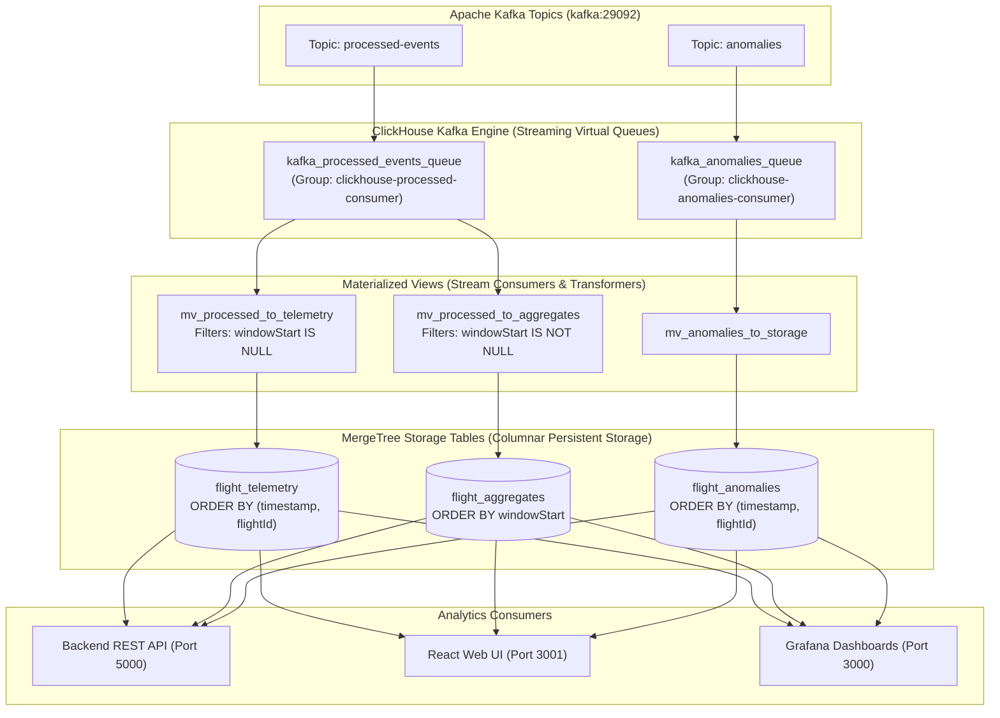

# 🗄️ ClickHouse Database Schema & Architecture Documentation

This document provides a comprehensive technical specification of the **ClickHouse Real-Time OLAP Data Warehouse** powering the Big Data Analytics (BDA) Flight Telemetry Pipeline.

---

## 📌 Executive Summary

- **Database Engine**: ClickHouse Server (`clickhouse/clickhouse-server:latest`)
- **Default Database**: `default`
- **Native Port**: `9000` (TCP client / Grafana Native datasource)
- **HTTP Port**: `8123` (REST queries / Web client / Health checks)
- **Default User**: `ch_user`
- **Access Management**: Role-based access with SQL user management enabled
- **Storage Engine**: `MergeTree` column-oriented table family with automatic background compaction and LZ4 compression.

---

## 🔄 End-to-End Ingestion Data Flow

ClickHouse ingests data in real time directly from Apache Kafka without requiring third-party connectors:



---

## 1. MergeTree Persistent Storage Tables

### 1.1 `flight_telemetry`

The primary storage table holding individual aircraft state vectors, geospatial coordinates, engine telemetry, and operational flight metadata.

#### DDL Statement:
```sql
CREATE TABLE default.flight_telemetry (
    eventId           String,
    timestamp         DateTime,
    flightId          String,
    callsign          String,
    latitude          Float64 DEFAULT 0.0,
    longitude         Float64 DEFAULT 0.0,
    altitudeFt        Int32,
    speedKnots        Int32,
    headingDeg        Int32 DEFAULT 0,
    verticalRateFpm   Int32 DEFAULT 0,
    squawk            String,
    status            String,
    engineTemperature Int32 DEFAULT 700,
    route             String,
    origin            String,
    destination       String
) ENGINE = MergeTree()
ORDER BY (timestamp, flightId)
SETTINGS index_granularity = 8192;
```

#### Detailed Column Dictionary:

| Column Name | Data Type | Default | Description | Sample Value |
|---|---|---|---|---|
| `eventId` | `String` | — | Unique telemetry event identifier assigned during generation | `sim_1792300773431_fe11eb` |
| `timestamp` | `DateTime` | — | UTC timestamp of the observation | `2026-10-18 05:19:33` |
| `flightId` | `String` | — | Unique flight identifier | `AAL100` |
| `callsign` | `String` | — | Aircraft radio callsign | `AAL100` |
| `latitude` | `Float64` | `0.0` | Aircraft latitude in decimal degrees (-90.0 to +90.0) | `53.4691` |
| `longitude` | `Float64` | `0.0` | Aircraft longitude in decimal degrees (-180.0 to +180.0) | `-102.2024` |
| `altitudeFt` | `Int32` | — | Pressure altitude in feet above sea level | `35000` |
| `speedKnots` | `Int32` | — | True airspeed in knots | `460` |
| `headingDeg` | `Int32` | `0` | Ground track / compass heading (0° – 359°) | `279` |
| `verticalRateFpm` | `Int32` | `0` | Vertical rate of climb/descent (feet per minute) | `0`, `-800`, `-1500` |
| `squawk` | `String` | — | 4-digit Mode-A / Mode-S transponder beacon code | `1200`, `2000`, `7700` |
| `status` | `String` | — | Aircraft operational flight status | `In-Flight`, `Emergency` |
| `engineTemperature` | `Int32` | `700` | Exhaust Gas Temperature (EGT) in Celsius (°C) | `685`, `925` |
| `route` | `String` | — | Origin-to-Destination airport route path | `YFB ➔ ANC` |
| `origin` | `String` | — | Origin airport IATA code | `YFB` |
| `destination` | `String` | — | Destination airport IATA code | `ANC` |

#### Indexing & Sorting Optimization:
- **`ORDER BY (timestamp, flightId)`**: The sparse primary index is ordered first by `timestamp`, then by `flightId`. This guarantees sub-millisecond range scans for time-window queries (e.g. `WHERE timestamp >= now() - INTERVAL 10 MINUTE`) and rapid binary lookups for individual flight trajectories.
- **`index_granularity = 8192`**: One index mark every 8,192 rows, keeping the memory index footprint minimal while optimizing columnar vector streaming.
- **Compression**: Column data achieves ~**75x compression ratio** under LZ4/ZSTD default compression.

---

### 1.2 `flight_anomalies`

Stores detected security emergencies, system failures, hazardous weather events, and critical mechanical thresholds flagged by the Spark Structured Streaming engine.

#### DDL Statement:
```sql
CREATE TABLE default.flight_anomalies (
    anomalyId         String,
    timestamp         DateTime,
    flightId          String,
    callsign          String,
    anomalyType       String,
    severity          String,
    details           String,
    altitudeFt        Int32,
    speedKnots        Int32,
    engineTemperature Int32,
    squawk            String
) ENGINE = MergeTree()
ORDER BY (timestamp, flightId)
SETTINGS index_granularity = 8192;
```

#### Detailed Column Dictionary:

| Column Name | Data Type | Description | Sample Value |
|---|---|---|---|
| `anomalyId` | `String` | Unique anomaly identifier (`anom_<timestamp>_<callsign>`) | `anom_1792300786359_AFR105` |
| `timestamp` | `DateTime` | Time anomaly was detected by the streaming engine | `2026-10-18 05:19:33` |
| `flightId` | `String` | Target flight identifier | `AFR105` |
| `callsign` | `String` | Target flight callsign | `AFR105` |
| `anomalyType` | `String` | Classification category of the anomaly condition | `MAYDAY_GENERAL_EMERGENCY` |
| `severity` | `String` | Alert urgency level (`EMERGENCY` or `WARNING`) | `EMERGENCY` |
| `details` | `String` | Human-readable alert summary string with flight attributes | `AFR105 \| Emergency \| Alt: 33500 \| EGT: 953C \| Squawk: 7700` |
| `altitudeFt` | `Int32` | Altitude at time of detection | `33500` |
| `speedKnots` | `Int32` | Speed at time of detection | `480` |
| `engineTemperature` | `Int32` | EGT temperature (°C) at time of detection | `953` |
| `squawk` | `String` | Transponder squawk code triggering or associated with alert | `7700` |

#### Anomaly Classification Rules:
- **`MAYDAY_GENERAL_EMERGENCY`** (`EMERGENCY`): Squawk = `7700`
- **`RADIO_COMMUNICATION_FAILURE`** (`WARNING`): Squawk = `7600`
- **`HIJACK_UNLAWFUL_INTERFERENCE`** (`EMERGENCY`): Squawk = `7500`
- **`ENGINE_OVERHEAT_CRITICAL`** (`EMERGENCY`): Engine Temperature ≥ `900°C` (Threshold reaches `EMERGENCY` at `≥ 920°C`)
- **`RAPID_DESCENT_ALERT`** (`WARNING`): Vertical rate ≤ `-1200 fpm`
- **`SEVERE_TURBULENCE_HAZARD`** (`WARNING`): Turbulence flag = `Severe`

---

### 1.3 `flight_aggregates`

Stores micro-batch and tumbling window summaries generated by Spark streaming aggregations for high-level BI dashboards.

#### DDL Statement:
```sql
CREATE TABLE default.flight_aggregates (
    windowStart   DateTime,
    windowEnd     DateTime,
    totalFlights  Int32,
    avgAltitude   Float64,
    avgSpeed      Float64,
    avgEngineTemp Float64,
    maxEngineTemp Int32,
    anomalyCount  Int32
) ENGINE = MergeTree()
ORDER BY windowStart
SETTINGS index_granularity = 8192;
```

#### Detailed Column Dictionary:

| Column Name | Data Type | Description |
|---|---|---|
| `windowStart` | `DateTime` | Start time boundary of the aggregate window |
| `windowEnd` | `DateTime` | End time boundary of the aggregate window |
| `totalFlights` | `Int32` | Total unique flights active during the window |
| `avgAltitude` | `Float64` | Fleet-wide average altitude in feet |
| `avgSpeed` | `Float64` | Fleet-wide average airspeed in knots |
| `avgEngineTemp` | `Float64` | Fleet-wide average engine temperature in Celsius |
| `maxEngineTemp` | `Int32` | Peak engine temperature observed in window |
| `anomalyCount` | `Int32` | Number of anomalies flagged in window |

---

## 2. Kafka Engine Streaming Queues

ClickHouse's `Kafka` table engine acts as an in-memory streaming consumer that continuously pulls JSON rows from Kafka topic partitions and buffers them for Materialized Views.

> **Note**: Reading directly with `SELECT * FROM kafka_*_queue` empties the buffer and advances Kafka offsets. Materialized Views handle reads automatically.

### 2.1 `kafka_processed_events_queue`

```sql
CREATE TABLE default.kafka_processed_events_queue (
    eventId           String,
    timestamp         String,
    flightId          String,
    callsign          String,
    latitude          Float64,
    longitude         Float64,
    altitudeFt        Int32,
    speedKnots        Int32,
    headingDeg        Int32,
    verticalRateFpm   Int32,
    squawk            String,
    status            String,
    engineTemperature Int32,
    route             String,
    origin            String,
    destination       String,
    -- Micro-batch summary fields (NULL for telemetry events)
    windowStart       Nullable(String),
    windowEnd         Nullable(String),
    totalFlights      Nullable(Int32),
    avgAltitude       Nullable(Float64),
    avgSpeed          Nullable(Float64),
    avgEngineTemp     Nullable(Float64),
    maxEngineTemp     Nullable(Int32),
    anomalyCount      Nullable(Int32)
) ENGINE = Kafka
SETTINGS 
    kafka_broker_list   = 'kafka:29092',
    kafka_topic_list    = 'processed-events',
    kafka_group_name    = 'clickhouse-processed-consumer',
    kafka_format        = 'JSONEachRow',
    kafka_num_consumers = 1;
```

### 2.2 `kafka_anomalies_queue`

```sql
CREATE TABLE default.kafka_anomalies_queue (
    anomalyId         String,
    timestamp         String,
    flightId          String,
    callsign          String,
    anomalyType       String,
    severity          String,
    details           String,
    altitudeFt        Int32,
    speedKnots        Int32,
    engineTemperature Int32,
    squawk            String
) ENGINE = Kafka
SETTINGS 
    kafka_broker_list   = 'kafka:29092',
    kafka_topic_list    = 'anomalies',
    kafka_group_name    = 'clickhouse-anomalies-consumer',
    kafka_format        = 'JSONEachRow',
    kafka_num_consumers = 1;
```

---

## 3. Materialized Views (Streaming Transformation Pipeline)

ClickHouse Materialized Views operate as continuous triggers. When records land in a Kafka queue, the materialized view executes its `SELECT` query, performs data cleansing and type-casting, and appends the result to the destination `MergeTree` table.

### 3.1 `mv_processed_to_telemetry`
- **Source**: `kafka_processed_events_queue`
- **Destination**: `flight_telemetry`
- **Filtering Logic**: Discards empty flight IDs and ignores summary rows where `windowStart IS NOT NULL`.

```sql
CREATE MATERIALIZED VIEW default.mv_processed_to_telemetry 
TO default.flight_telemetry AS
SELECT
    eventId,
    parseDateTimeBestEffort(timestamp) AS timestamp,
    flightId,
    callsign,
    latitude,
    longitude,
    altitudeFt,
    speedKnots,
    headingDeg,
    verticalRateFpm,
    squawk,
    status,
    engineTemperature,
    route,
    origin,
    destination
FROM default.kafka_processed_events_queue
WHERE (flightId != '') AND (flightId != 'UNK') AND (windowStart IS NULL);
```

### 3.2 `mv_anomalies_to_storage`
- **Source**: `kafka_anomalies_queue`
- **Destination**: `flight_anomalies`

```sql
CREATE MATERIALIZED VIEW default.mv_anomalies_to_storage 
TO default.flight_anomalies AS
SELECT
    anomalyId,
    parseDateTimeBestEffort(timestamp) AS timestamp,
    flightId,
    callsign,
    anomalyType,
    severity,
    details,
    altitudeFt,
    speedKnots,
    engineTemperature,
    squawk
FROM default.kafka_anomalies_queue;
```

### 3.3 `mv_processed_to_aggregates`
- **Source**: `kafka_processed_events_queue`
- **Destination**: `flight_aggregates`
- **Filtering Logic**: Only processes rows containing non-null window statistics (`WHERE windowStart IS NOT NULL`).

```sql
CREATE MATERIALIZED VIEW default.mv_processed_to_aggregates 
TO default.flight_aggregates AS
SELECT
    parseDateTimeBestEffort(windowStart) AS windowStart,
    parseDateTimeBestEffort(windowEnd)   AS windowEnd,
    totalFlights,
    avgAltitude,
    avgSpeed,
    avgEngineTemp,
    maxEngineTemp,
    anomalyCount
FROM default.kafka_processed_events_queue
WHERE windowStart IS NOT NULL;
```

---

## 4. Key Performance SQL Patterns & Recipes

### 4.1 Latest Position for All Flights (Deduplicated State Vector)
To query the current live position of every aircraft without scanning redundant past states:

```sql
SELECT
    flightId,
    argMax(callsign, timestamp)          AS callsign,
    argMax(latitude, timestamp)          AS latitude,
    argMax(longitude, timestamp)         AS longitude,
    argMax(altitudeFt, timestamp)        AS altitudeFt,
    argMax(speedKnots, timestamp)        AS speedKnots,
    argMax(headingDeg, timestamp)        AS headingDeg,
    argMax(status, timestamp)            AS status,
    argMax(engineTemperature, timestamp) AS engineTemperature,
    argMax(route, timestamp)             AS route,
    max(timestamp)                       AS lastTelemetryUpdate
FROM default.flight_telemetry
WHERE timestamp >= now() - INTERVAL 5 MINUTE
GROUP BY flightId
ORDER BY flightId ASC;
```

### 4.2 Single Flight Historical Trajectory Breadcrumbs
```sql
SELECT
    timestamp,
    latitude,
    longitude,
    altitudeFt,
    speedKnots,
    headingDeg,
    engineTemperature
FROM default.flight_telemetry
WHERE flightId = 'AAL100'
ORDER BY timestamp ASC
LIMIT 300;
```

### 4.3 Ingestion Rate (Velocity Per Minute)
```sql
SELECT
    toStartOfMinute(timestamp) AS time,
    count()                    AS events_per_min
FROM default.flight_telemetry
WHERE timestamp >= now() - INTERVAL 1 HOUR
GROUP BY time
ORDER BY time ASC;
```

### 4.4 Table Storage Footprint & Compression Efficiency
```sql
SELECT
    table,
    count()                                                         AS active_parts,
    formatReadableQuantity(sum(rows))                               AS total_rows,
    formatReadableSize(sum(bytes_on_disk))                          AS compressed_disk_size,
    formatReadableSize(sum(data_uncompressed_bytes))                AS uncompressed_size,
    round(sum(data_uncompressed_bytes) / sum(bytes_on_disk), 2)     AS compression_ratio
FROM system.parts
WHERE active = 1 AND database = 'default'
GROUP BY table
ORDER BY sum(bytes_on_disk) DESC;
```

---

## 5. Schema Maintenance & Startup Scripts

- **Initial Setup Script**: [`docker/clickhouse/init/01_create_tables.sql`](file:///home/chansom163/Academics/BDA/project/BDA-Project/docker/clickhouse/init/01_create_tables.sql)
  Executed on first container database initialization.
- **Persistent Initializer**: [`docker/clickhouse/init-schema.sh`](file:///home/chansom163/Academics/BDA/project/BDA-Project/docker/clickhouse/init-schema.sh)
  Runs on every compose startup via `bda-clickhouse-init` to ensure Kafka Engine tables and Materialized Views exist even if volumes already persist.
- **Complete Cleanup Script**: [`scripts/clean.sh`](file:///home/chansom163/Academics/BDA/project/BDA-Project/scripts/clean.sh)
  Wipes all persistent database parts, checkpoint volumes, and container state on disk.
